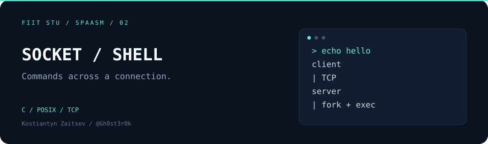
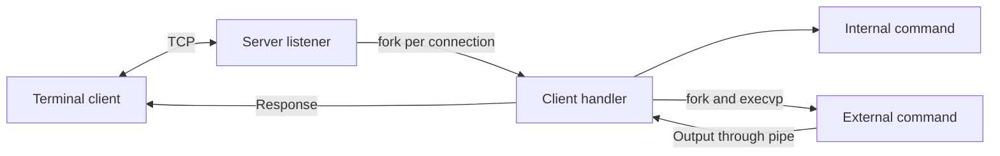

# Socket Shell

A terminal client and TCP command server written in **C for Linux**. The client sends commands over a socket; the server runs them in child processes and returns their output. Built as a systems programming assignment exploring POSIX processes, file descriptors, and network I/O.

**[Quick start](#quick-start) · [Try a session](#try-a-session) · [Inside the project](#inside-the-project) · [Companion project ↗](https://github.com/Gh0st3r0k/FIIT-STU-SPAASM-Zadanie1)**

## What it does

- Handles client connections with a process-per-client server.
- Runs external commands using `fork`, `execvp`, pipes, and `waitpid`.
- Supports input/output redirection, `;` command separators, and `#` comments.
- Tracks clients in shared memory and disconnects inactive sessions.
- Offers a customizable client prompt, verbose output, and optional file logging.

## Quick start

Requires **Linux**, **GCC**, and **Make**. There are no third-party library dependencies.

```sh
make
./spaasm -h
```

Start the server in one terminal from the repository root:

```sh
./spaasm -s -p 45678 -t 60 -v
```

Connect from a second terminal:

```sh
./spaasm -c -p 45678
```

The client connects to `127.0.0.1`. The server listens on all interfaces. Run this educational command server only in a trusted, isolated environment: connections are unauthenticated and commands execute with the server user's permissions.

## Try a session

Enter these commands one at a time in the client:

```text
help
echo hello-from-spaasm
stat
prompt username Gh0st3r0k
prompt end $
quit
```

`echo hello-from-spaasm` returns:

```text
hello-from-spaasm
```

`stat` lists active client slots, process IDs, file descriptors, and IP addresses. Prompt changes happen locally in the client.

For a small redirection demo, enter:

```text
echo saved-by-spaasm > /tmp/spaasm-demo.txt
cat < /tmp/spaasm-demo.txt
```

Relative file paths and external commands are resolved in the **server's** working directory and environment.

### Internal commands

| Command | Behavior |
| :--- | :--- |
| `help` | Show commands and supported syntax |
| `stat` | List active clients |
| `abort <index>` | Request disconnection of a client slot |
| `quit` | Close the current client connection |
| `halt` | Stop the server and signal its process group |
| `prompt <field> <value>` | Customize `time`, `username`, `devicename`, or `end` locally |

Use `prompt time 1` for hours/minutes or `prompt time 2` to include seconds. Start the server in its own terminal or process group when using `halt`.

### Program options

| Option | Purpose |
| :--- | :--- |
| `-h` | Show help |
| `-s` / `-c` | Select server / client mode; server is the default |
| `-p PORT` | Set the required TCP port |
| `-t SECONDS` | Set server-side client inactivity timeout; default: 30 seconds |
| `-v` | Print debug messages to standard error |
| `-l FILE` | Write a log file; the file is overwritten on startup |

## Inside the project



| File | Responsibility |
| :--- | :--- |
| [`main.c`](main.c) | CLI options and server/client selection |
| [`server.c`](server.c) | Sockets, client processes, shared state, and inactivity timeout |
| [`client.c`](client.c) | Interactive socket I/O and local prompt commands |
| [`shell.c`](shell.c), [`shell.h`](shell.h) | Command dispatch, process execution, and redirection |
| [`prompt.c`](prompt.c), [`prompt.h`](prompt.h) | Time, identity, hostname, and prompt formatting |
| [`Makefile`](Makefile) | GCC build and cleanup |

## Scope and limits

The command parser is intentionally small: it is not a full POSIX shell. Quoting, escaping, pipelines, and shell expansion are not implemented. Client/server buffers are 1,024 bytes; the client table has 128 slots. TCP response handling uses an `__END__` marker rather than a general framed protocol. Authentication, encryption, and production hardening are outside the assignment's scope.

Build artifacts can be removed with `make clean`. There is no bundled automated test suite; the session above provides a functional smoke check.

## About

**Kostiantyn Zaitsev · [@Gh0st3r0k](https://github.com/Gh0st3r0k)**

FIIT STU · SPAASM · Assignment 2

Part of a pair of systems programming assignments. See **[ASCII Analyzer](https://github.com/Gh0st3r0k/FIIT-STU-SPAASM-Zadanie1)** for character processing in x86-64 assembly.
